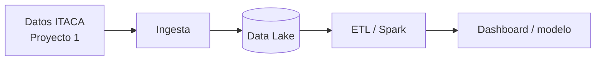

# Proyecto 2 · ITACA (parte 2)

## Descripción y objetivo

Segunda parte del proyecto ITACA. Parte de los datos académicos **anonimizados** ya trabajados en el Proyecto 1 y amplía el pipeline con almacenamiento en Data Lake, procesamiento distribuido y analítica avanzada.

**Objetivo:** Escalar el procesamiento de los datos de ITACA y obtener un dashboard ampliado y, si procede, un modelo predictivo de rendimiento académico.

> [!NOTE]
> Los datos de alumnado deben estar siempre anonimizados.

## Arquitectura

*Diagrama provisional (Bloque 0). Se actualizará al terminar cada bloque.*

## Fuentes de datos

| Fuente | URL / origen | Formato | Frecuencia de actualización | Licencia | Última ingesta |
|---|---|---|---|---|---|
| [Fuente] | [URL] | [CSV/JSON/XML/BD] | [diaria/horaria/única] | [licencia] | [fecha] |

## Estructura del repositorio

| Carpeta | Contenido |
|---|---|
| `ingesta/` | Scripts de extracción y carga de datos |
| `etl/` | Transformaciones y limpieza de datos |
| `dashboard/` | Dashboards e informes de visualización |
| `.gitignore` | Ficheros excluidos del control de versiones (datos, credenciales, entornos) |
| `README.md` | Documentación del proyecto |

## Cómo desplegar el entorno

*Pendiente: el `docker-compose.yml` de este proyecto se añadirá cuando llegue su bloque correspondiente.*

## Bitácora de prácticas

### Bloque 0 · Entorno

- **Objetivo:** [ ]
- **Pasos realizados:** [ ]
- **Problemas encontrados y solución:** [ ]
- **Resultado:** [ ]

### Bloque 1 · Ingesta batch

- **Objetivo:** [ ]
- **Pasos realizados:** [ ]
- **Problemas encontrados y solución:** [ ]
- **Resultado:** [ ]

### Bloque 2 · Bases de datos NoSQL

- **Objetivo:** [ ]
- **Pasos realizados:** [ ]
- **Problemas encontrados y solución:** [ ]
- **Resultado:** [ ]

### Bloque 3 · Data Lake

- **Objetivo:** [ ]
- **Pasos realizados:** [ ]
- **Problemas encontrados y solución:** [ ]
- **Resultado:** [ ]

### Bloque 4 · Procesamiento con Spark

- **Objetivo:** [ ]
- **Pasos realizados:** [ ]
- **Problemas encontrados y solución:** [ ]
- **Resultado:** [ ]

### Bloque 5 · Streaming con Kafka

- **Objetivo:** [ ]
- **Pasos realizados:** [ ]
- **Problemas encontrados y solución:** [ ]
- **Resultado:** [ ]

### Bloque 6 · FIWARE e IoT

- **Objetivo:** [ ]
- **Pasos realizados:** [ ]
- **Problemas encontrados y solución:** [ ]
- **Resultado:** [ ]

### Bloque 7 · Orquestación, calidad y gobierno

- **Objetivo:** [ ]
- **Pasos realizados:** [ ]
- **Problemas encontrados y solución:** [ ]
- **Resultado:** [ ]

#### Catálogo de datos

| Nombre | Ubicación | Descripción | Esquema | Frecuencia | Responsable | Sensibilidad |
|---|---|---|---|---|---|---|
| [tabla] | [ruta / colección] | [ ] | [ ] | [ ] | [ ] | [baja/media/alta] |

### Bloque 8 · Visualización

- **Objetivo:** [ ]
- **Pasos realizados:** [ ]
- **Problemas encontrados y solución:** [ ]
- **Resultado:** [ ]

### Bloque 9 · Inteligencia artificial

- **Objetivo:** [ ]
- **Pasos realizados:** [ ]
- **Problemas encontrados y solución:** [ ]
- **Resultado:** [ ]

### Bloque 10 · Nube

- **Objetivo:** [ ]
- **Pasos realizados:** [ ]
- **Problemas encontrados y solución:** [ ]
- **Resultado:** [ ]

## Decisiones técnicas

| Decisión | Alternativa descartada | Motivo |
|---|---|---|
| [ ] | [ ] | [ ] |

## Incidencias resueltas

- **Problema:** [ ] **Causa:** [ ] **Solución:** [ ]

## Resultado final

*Capturas del dashboard y del modelo, y enlace al vídeo o a la demo si la hay.*
