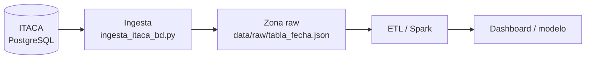
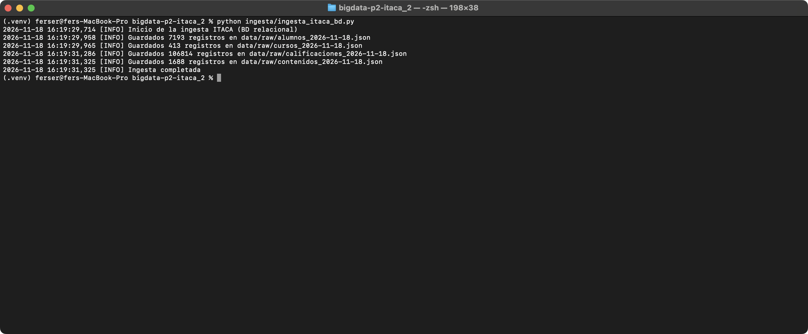
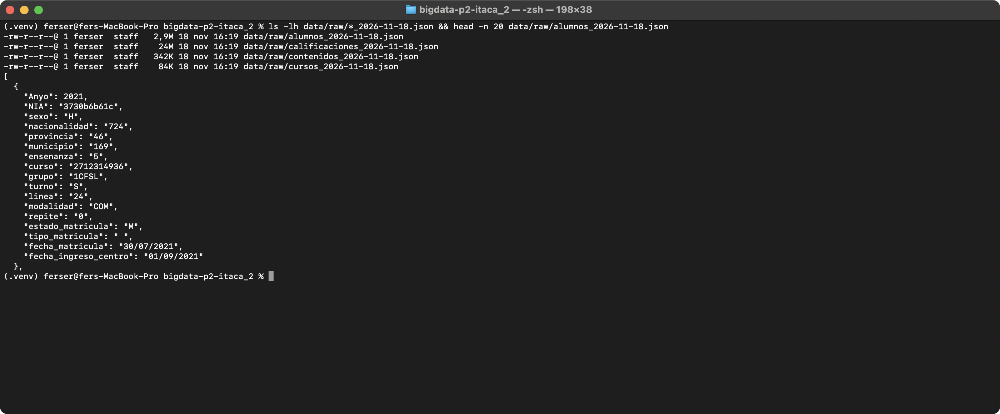

# Proyecto 2 · ITACA (parte 2)

## Descripción y objetivo

Segunda parte del proyecto ITACA. Parte de los datos académicos **anonimizados** ya trabajados en el Proyecto 1 y amplía el pipeline con almacenamiento en Data Lake, procesamiento distribuido y analítica avanzada.

**Objetivo:** Escalar el procesamiento de los datos de ITACA y obtener un dashboard ampliado y, si procede, un modelo predictivo de rendimiento académico.

> [!NOTE]
> Los datos de alumnado deben estar siempre anonimizados.

## Arquitectura

*Diagrama provisional (Bloque 0). Se actualizará al terminar cada bloque.*



## Fuentes de datos

Origen: base de datos de ejemplo de ITACA del centro 46019660 (CIPFP Mislata), con la misma estructura que una réplica PostgreSQL de ITACA. Se carga en el contenedor `bigdata-postgres` desde los volcados SQL de `data/raw/sqlBigData/` con `ingesta/cargar_sql.sh`. Cada tabla reúne todos los cursos escolares (2021 a 2025) y la columna `anyo` indica el curso.

**Mecanismo de acceso:** conexión a la BD PostgreSQL (`localhost:5433`, base de datos `itaca`). Desde Python se usa el driver `psycopg2`, el equivalente a JDBC.

**Autenticación:** usuario `lectura_bigdata`, que solo tiene permiso `SELECT` sobre las tablas. Las credenciales están en el `.env` (`DB_HOST`, `DB_PORT`, `DB_NAME`, `DB_USER`, `DB_PASSWORD`), que no se versiona. La plantilla está en `.env.example`.

| Fuente | URL / origen | Formato | Frecuencia de actualización | Licencia | Última ingesta |
|---|---|---|---|---|---|
| Alumnos | PostgreSQL `itaca.alumnos` | BD | Anual (una carga por curso escolar) | Datos internos del centro (anonimizados) | 2026-11-18 |
| Cursos | PostgreSQL `itaca.cursos` | BD | Anual (una carga por curso escolar) | Datos internos del centro | 2026-11-18 |
| Calificaciones | PostgreSQL `itaca.calificaciones` | BD | Anual (una carga por curso escolar) | Datos internos del centro (anonimizados) | 2026-11-18 |
| Contenidos | PostgreSQL `itaca.contenidos` | BD | Anual (una carga por curso escolar) | Datos internos del centro | 2026-11-18 |

Campos extraídos (modelo de datos del apartado 4):

| Tabla | Campos |
|---|---|
| `cursos` | Anyo, codigo, nombre_cas, nombre_val, abreviatura, ensenanza, padre |
| `alumnos` | Anyo, NIA, sexo, nacionalidad, provincia, municipio, ensenanza, curso, grupo, turno, linea, modalidad, repite, estado_matricula, tipo_matricula, fecha_matricula, fecha_ingreso_centro |
| `contenidos` | Anyo, codigo, nombre_cas, nombre_val, ensenanza, curso |
| `calificaciones` | Anyo, evaluacion, alumno, ensenanza, curso, contenido, bloque_contenido, nota_numerica, tipo_nota |

La tabla `alumnos` de la BD también tiene datos personales (nombre, apellidos, fecha de nacimiento, documento, teléfonos, emails, SIP, expediente…). Esos campos no se extraen.

Relaciones (claves compuestas): `calificaciones.(alumno, Anyo, curso)` → `alumnos.(NIA, Anyo, curso)`; `calificaciones.(contenido, Anyo, curso)` → `contenidos.(codigo, Anyo, curso)`; `alumnos.(curso, Anyo)` → `cursos.(codigo, Anyo)`.

## Estructura del repositorio

| Carpeta | Contenido |
|---|---|
| `ingesta/` | Scripts de carga de la BD de ejemplo (`cargar_sql.sh`) y de ingesta (`ingesta_itaca_bd.py`) |
| `data/raw/sqlBigData/` | Volcados SQL de la BD de ejemplo, un fichero por tabla (excluido de Git) |
| `data/raw/` | Zona raw: JSON generados por la ingesta (excluido de Git) |
| `logs/` | Logs de ejecución de la ingesta (excluido de Git) |
| `capturas/` | Capturas de la ejecución de las prácticas |
| `etl/` | Transformaciones y limpieza de datos |
| `dashboard/` | Dashboards e informes de visualización |
| `docker-compose.yml` | Servicios del entorno (PostgreSQL) |
| `.env.example` | Plantilla de las variables del `.env` |
| `.gitignore` | Ficheros excluidos del control de versiones (datos, credenciales, entornos) |
| `README.md` | Documentación del proyecto |

## Cómo desplegar el entorno

```bash
cp .env.example .env          # y cambiar las contraseñas
docker compose up -d
docker compose ps
```

Levanta un contenedor `bigdata-postgres` (PostgreSQL 16) accesible en `localhost:5433`, con los datos persistidos en el volumen `postgres-data`.

## Bitácora de prácticas

### Bloque 0 · Entorno

- **Objetivo:** [ ]
- **Pasos realizados:** [ ]
- **Problemas encontrados y solución:** [ ]
- **Resultado:** [ ]

### Bloque 1 · Ingesta batch

#### Práctica P2 · Ingesta de datos ITACA (BD relacional)

- **Objetivo:** Ingestar los datos académicos de ITACA desde la base de datos PostgreSQL (alumnos, cursos, calificaciones y contenidos), anonimizar el NIA y guardar cada tabla como JSON en la zona raw (`data/raw/`).
- **Pasos realizados:**
  1. **Análisis de la fuente:** documentado en [Fuentes de datos](#fuentes-de-datos).
  2. **Preparación del entorno:**
     ```bash
     python3 -m venv .venv
     source .venv/bin/activate   # En Windows: .venv\Scripts\activate
     pip install psycopg2-binary python-dotenv pandas
     ```
     Carga de la BD de ejemplo con `./ingesta/cargar_sql.sh` y creación del usuario de solo lectura (con el administrador `bigdata`):
     ```sql
     CREATE ROLE lectura_bigdata LOGIN PASSWORD '...';   -- la misma que DB_PASSWORD del .env
     GRANT CONNECT ON DATABASE itaca TO lectura_bigdata;
     GRANT USAGE ON SCHEMA public TO lectura_bigdata;
     GRANT SELECT ON ALL TABLES IN SCHEMA public TO lectura_bigdata;
     ALTER DEFAULT PRIVILEGES FOR ROLE bigdata IN SCHEMA public GRANT SELECT ON TABLES TO lectura_bigdata;
     ```
     El `ALTER DEFAULT PRIVILEGES` mantiene el permiso de lectura aunque `cargar_sql.sh` vuelva a crear las tablas. Las credenciales de conexión van en el `.env`.
  3. **Script de ingesta** [`ingesta/ingesta_itaca_bd.py`](ingesta/ingesta_itaca_bd.py): se completa el esqueleto de la práctica (`conectar`, `extraer_tabla`, `guardar`) con los campos de cada tabla del paso 3. Cada tabla se guarda en `data/raw/<tabla>_<fecha>.json`.
  4. **Anonimización del NIA:** antes de guardar, `alumnos.NIA` y `calificaciones.alumno` se sustituyen por `anonimizar_nia(nia)` (`sha256(NIA)[:10]`). El hash se genera una sola vez por NIA original (se guarda en un diccionario) y se reutiliza en las dos tablas, así que se pueden seguir cruzando.
  5. **Ejecución y verificación:**
     ```bash
     python ingesta/ingesta_itaca_bd.py
     ```
- **Buenas prácticas aplicadas (apartado 6):**
  - Credenciales en `.env`, que no se versiona.
  - Usuario de BD con permiso solo de `SELECT`. Un `DELETE` con `lectura_bigdata` devuelve `permission denied`.
  - Logging con fecha y nivel, por consola y en `logs/ingesta_<fecha>.log`.
  - Manejo de errores con `try/except` y `logger.exception`, y la conexión se cierra siempre en un `finally`.
  - Código de salida `0` si todo va bien o `1` si falla.
- **Problemas encontrados y solución:**
  - El esqueleto hace `SELECT *`, pero eso sacaría de la BD los datos personales de `alumnos`. Se seleccionan solo los campos del modelo, construyendo la consulta con `psycopg2.sql`.
  - En la BD las columnas están en minúscula (`anyo`, `nia`). Se renombran en la consulta (`anyo AS "Anyo"`, `nia AS "NIA"`) para que coincidan con el modelo de datos.
  - El esqueleto incluye una tabla `modulos` que no existe en la BD. Los módulos están en `contenidos`, y se ingestan las cuatro tablas del paso 3.
- **Resultado:** ejecución del 2026-11-18 sin errores (código de salida 0).

  | Tabla | 2021 | 2022 | 2023 | 2024 | 2025 | Total |
  |---|---|---|---|---|---|---|
  | alumnos | 1.341 | 1.411 | 1.445 | 1.465 | 1.531 | 7.193 |
  | cursos | 70 | 71 | 68 | 94 | 110 | 413 |
  | calificaciones | 18.906 | 20.324 | 19.130 | 22.510 | 25.944 | 106.814 |
  | contenidos | 265 | 278 | 260 | 372 | 513 | 1.688 |

  Verificación (paso 5):
  - En los JSON no aparece ningún NIA original: solo los 4.298 NIA anonimizados. No hay nombre, apellidos, documento, teléfonos ni emails porque esos campos no se extraen.
  - Se han generado las cuatro tablas en `data/raw/`.
  - Coherencia de claves: todo `(contenido, Anyo, curso)` de calificaciones existe en contenidos y todo `(curso, Anyo)` de alumnos existe en cursos. En calificaciones hay 397 combinaciones `(alumno, Anyo, curso)` sin correspondencia en alumnos: en 388 el alumno está matriculado ese año en otro curso, y 9 alumnos tienen notas sin matrícula ese año. No se corrige en la ingesta (principio de la zona raw).

  Capturas:
  - Script en ejecución:

    

  - Ficheros JSON en `data/raw/`:

    

### Bloque 2 · Bases de datos NoSQL

- **Objetivo:** [ ]
- **Pasos realizados:** [ ]
- **Problemas encontrados y solución:** [ ]
- **Resultado:** [ ]

### Bloque 3 · Data Lake

- **Objetivo:** [ ]
- **Pasos realizados:** [ ]
- **Problemas encontrados y solución:** [ ]
- **Resultado:** [ ]

### Bloque 4 · Procesamiento con Spark

- **Objetivo:** [ ]
- **Pasos realizados:** [ ]
- **Problemas encontrados y solución:** [ ]
- **Resultado:** [ ]

### Bloque 5 · Streaming con Kafka

- **Objetivo:** [ ]
- **Pasos realizados:** [ ]
- **Problemas encontrados y solución:** [ ]
- **Resultado:** [ ]

### Bloque 6 · FIWARE e IoT

- **Objetivo:** [ ]
- **Pasos realizados:** [ ]
- **Problemas encontrados y solución:** [ ]
- **Resultado:** [ ]

### Bloque 7 · Orquestación, calidad y gobierno

- **Objetivo:** [ ]
- **Pasos realizados:** [ ]
- **Problemas encontrados y solución:** [ ]
- **Resultado:** [ ]

#### Catálogo de datos

| Nombre | Ubicación | Descripción | Esquema | Frecuencia | Responsable | Sensibilidad |
|---|---|---|---|---|---|---|
| [tabla] | [ruta / colección] | [ ] | [ ] | [ ] | [ ] | [baja/media/alta] |

### Bloque 8 · Visualización

- **Objetivo:** [ ]
- **Pasos realizados:** [ ]
- **Problemas encontrados y solución:** [ ]
- **Resultado:** [ ]

### Bloque 9 · Inteligencia artificial

- **Objetivo:** [ ]
- **Pasos realizados:** [ ]
- **Problemas encontrados y solución:** [ ]
- **Resultado:** [ ]

### Bloque 10 · Nube

- **Objetivo:** [ ]
- **Pasos realizados:** [ ]
- **Problemas encontrados y solución:** [ ]
- **Resultado:** [ ]

## Decisiones técnicas

| Decisión | Alternativa descartada | Motivo |
|---|---|---|
| Conexión con `psycopg2` y usuario `lectura_bigdata` (solo `SELECT`) | Conectar con el administrador `bigdata` | La ingesta solo necesita leer: si las credenciales se filtran, no se puede modificar la BD |
| Seleccionar solo los campos del modelo | `SELECT *` del esqueleto | Los datos personales de `alumnos` no salen de la BD |
| Anonimizar el NIA con `sha256(NIA)[:10]` | Guardar el NIA real / IDs aleatorios | El NIA es un dato identificativo. El hash determinista mantiene el mismo identificador en alumnos y calificaciones, así que las tablas se pueden seguir cruzando |
| Guardar los valores tal cual vienen de la BD | Convertir tipos o limpiar en la ingesta | Principio de la zona raw: la limpieza se hace en fases posteriores |
| `.env`, `data/raw/` y `logs/` excluidos de Git | Versionar credenciales y datos | Contienen credenciales y datos del alumnado |

## Incidencias resueltas

- **Problema:** el `SELECT *` del esqueleto habría volcado a raw el nombre, el documento, los teléfonos y los emails del alumnado. **Causa:** la tabla `alumnos` de la BD guarda todos los datos personales. **Solución:** consultar solo los campos del modelo de datos.

## Resultado final

*Capturas del dashboard y del modelo, y enlace al vídeo o a la demo si la hay.*
